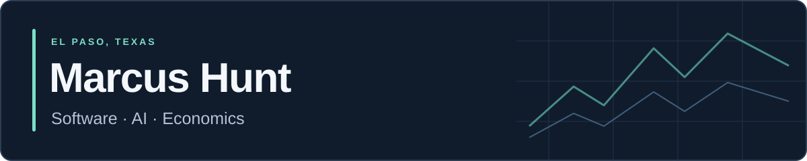

I'm a student developer in El Paso, Texas, working across **applied AI, economic research, and community technology**. I build tools that make complex information more useful and help students become technology creators.

**Founder, Fiesta Code & AI · 2024 Congressional App Challenge district winner**

[LinkedIn](https://www.linkedin.com/in/marcus-h-4a3388375/) · [Explore my repositories](https://github.com/MarcusHunt090?tab=repositories)

## Selected projects

### [BorderPulse](https://github.com/MarcusHunt090/borderpulse)
A reproducible economic-stress dashboard for the El Paso–Juárez Borderplex. Combines seven public indicators with backtesting, sensitivity analysis, and transparent reporting of the model's limitations.

`Python` `NumPy` `SciPy` `scikit-learn` · [Technical note](https://github.com/MarcusHunt090/borderpulse/blob/main/technical_note.md)

### [FinSentiment](https://github.com/MarcusHunt090/nlp-finance)
A financial NLP application for article and text analysis, classical-model comparisons, sentence-level sentiment, explainability, and optional FinBERT predictions.

`Python` `Flask` `scikit-learn` `NLTK` `Transformers`

### [Financial Headline Risk Analyzer](https://github.com/MarcusHunt090/financial-risk-analyzer-89)
A full-stack prototype combining sentiment and topic classification with an interpretable, rule-based headline risk score.

`FastAPI` `Next.js` `TypeScript` `scikit-learn`

## Community impact

- **CareCompanion:** Co-created an accessible iOS caregiving app; **1st Place, 2024 Congressional App Challenge, Texas District 16**. [Official feature](https://www.congressionalappchallenge.us/24-TX16/)
- **Fiesta Code & AI:** Founded a free, bilingual coding and AI initiative; reached **100+ students** through six community workshops and approximately **150 volunteer hours**.
- **El Pasoans Fighting Hunger:** Contributed **400+ volunteer hours** and helped lead a bilingual, mobile-first website redesign with El Paso Labs, including client research, a food-assistance map, and chatbot development.

## Current interests

Interpretable machine learning, regional economics, accessible digital tools, and STEM education. At Coronado High School, I founded the AI Leadership Club and serve as Coding Club Director of Programming.
